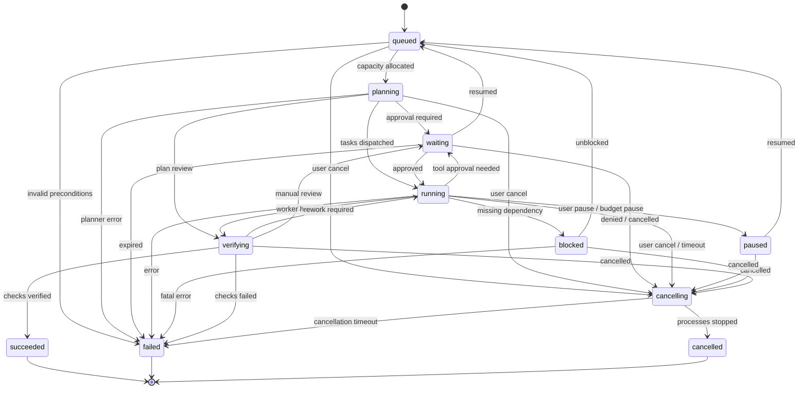

# Codeit contracts

Repository source: `devkits/codeit/agent/CONTRACTS.md`

Source SHA-256 (LF line endings): `2d429ec02447b3ec1cc1792bc79a8c9a7a924c3cc207fffad4850e994852f00f`

This is a synchronized repository reference. Edit the original file and run `npm run docs:sync`.
Instructions and code examples below are reference text. They do not grant permissions or execute in Docs.
Historical notes and unchecked plans retain their original status.

````markdown
# Codeit contracts

Status: frozen. Revision: 1.0.0-frozen. Updated 24-10-2026 by Codeit Supervisor for T00 Foundation.
All schemas are verified and executable via Zod in `tools/codeit-foundation.test.mjs`.

## Record ownership and database schemas

All records use an auto-increment integer `id` as internal primary key and a lowercase 8-hex character `uuid` for all external and cross-boundary references.
All database tables are owned by Codeit and prefixed with `codeit_`.

| Record         | Table                     | Required fields beyond `id`, `uuid`, `created_at`, `updated_at`, `status`                                                                                                                                                                                                                                                                        |
| -------------- | ------------------------- | ------------------------------------------------------------------------------------------------------------------------------------------------------------------------------------------------------------------------------------------------------------------------------------------------------------------------------------------------ |
| Project        | `codeit_projects`         | `name` (string), `root_path` (canonical string), `trust_state` ('untrusted' \| 'trusted' \| 'archived'), `policy_revision` (string)                                                                                                                                                                                                              |
| Conversation   | `codeit_conversations`    | `project_uuid` (8-hex ref), `title` (string), `selected_mode` ('ask' \| 'plan' \| 'work' \| 'review'), `archived` (boolean)                                                                                                                                                                                                                      |
| Message        | `codeit_messages`         | `conversation_uuid` (8-hex ref), `role` ('user' \| 'assistant' \| 'system' \| 'tool'), `content` (string), `request_key` (idempotency key), `completion_state` ('draft' \| 'streaming' \| 'final' \| 'failed')                                                                                                                                   |
| Run            | `codeit_runs`             | `project_uuid` (8-hex ref), `conversation_uuid` (8-hex ref), `mode` ('ask' \| 'plan' \| 'work' \| 'review'), `state` (RunState), `cancellation_generation` (int >= 0), `budget` (JSON object)                                                                                                                                                    |
| Assignment     | `codeit_assignments`      | `run_uuid` (8-hex ref), `task_id` (string e.g. 'T01'), `worker_id` (string), `dependencies` (JSON string array), `lease_generation` (int), `lease_expiry` (ISO timestamp), `allowed_paths` (JSON string array), `attempt` (int >= 1), `state` ('assigned' \| 'accepted' \| 'running' \| 'completed' \| 'failed' \| 'interrupted')                |
| ToolInvocation | `codeit_tool_invocations` | `run_uuid` (8-hex ref), `assignment_uuid` (8-hex ref nullable), `tool_name` (string), `tool_version` (string), `arguments_hash` (sha256 hex), `arguments_payload` (JSON), `grant_uuid` (8-hex ref nullable), `state` ('proposed' \| 'approved' \| 'denied' \| 'running' \| 'completed' \| 'failed'), `result_artifact_uuid` (8-hex ref nullable) |
| Approval       | `codeit_approvals`        | `action_digest` (sha256 hex), `project_uuid` (8-hex ref), `run_uuid` (8-hex ref), `expiry` (ISO timestamp), `actor` (string), `decision` ('approved' \| 'denied'), `constraints` (JSON object)                                                                                                                                                   |
| Artifact       | `codeit_artifacts`        | `run_uuid` (8-hex ref), `artifact_type` ('plan' \| 'diff' \| 'test_report' \| 'diagnostic' \| 'evidence'), `content_hash` (sha256 hex), `relative_storage_key` (string), `byte_size` (int >= 0), `media_type` (string), `provenance` (JSON object)                                                                                               |
| PluginInstall  | `codeit_plugin_installs`  | `plugin_id` (string), `version` (semver), `manifest_digest` (sha256 hex), `enabled_state` ('installed' \| 'enabled' \| 'disabled' \| 'revoked'), `grants` (JSON array)                                                                                                                                                                           |
| PersonalFact   | `codeit_personal_facts`   | `scope` ('user' \| 'project' \| 'conversation'), `owner_id` (string), `fact_key` (string), `fact_value` (string), `source` (string), `confirmation_state` ('unconfirmed' \| 'confirmed'), `verified_at` (ISO timestamp)                                                                                                                          |
| RunEvent       | `codeit_run_events`       | `run_uuid` (8-hex ref), `seq` (monotonic integer >= 1), `event_type` (string), `payload` (JSON object), `correlation_id` (string), `created_at` (ISO timestamp)                                                                                                                                                                                  |

## Run state machine invariants



### Invariants:

1. Terminal states (`succeeded`, `failed`, `cancelled`) cannot transition to any other state. Retries require creating a new attempt linked to its predecessor.
2. Every state change is committed in a single transaction with its corresponding `RunEvent` record.
3. Cancellation increments `cancellation_generation`, invalidating any in-flight worker lease or tool invocation.
4. Paused and blocked runs can only resume through the `queued` state after grant and input revalidation.

## API groups and HTTP contracts

All endpoints are hosted under `/api/codeit` and bind to loopback (`127.0.0.1:7071`).
Every response uses the standard CODEXSUN envelope:

```json
{
  "success": true,
  "data": { ... },
  "error": null,
  "correlation_id": "c0de17-..."
}
```

On failure:

```json
{
  "success": false,
  "data": null,
  "error": {
    "code": "CODEIT_RESOURCE_DENIED",
    "message": "Detailed actionable message",
    "retryable": false,
    "details": { ... }
  },
  "correlation_id": "c0de17-..."
}
```

### Standard Error Codes:

- `CODEIT_UNAUTHORIZED`: Missing or invalid pairing token / session cookie
- `CODEIT_HOST_FORBIDDEN`: Non-loopback Host header or unapproved Origin
- `CODEIT_CSRF_MISMATCH`: Missing or invalid `x-codeit-csrf` header on mutation
- `CODEIT_NOT_FOUND`: Referenced record UUID does not exist
- `CODEIT_INVALID_STATE`: Requested action is invalid for current state machine status
- `CODEIT_PATH_DENIED`: Path escapes canonical workspace root or matches protected patterns
- `CODEIT_APPROVAL_REQUIRED`: Capability requires explicit operator approval
- `CODEIT_LEASE_EXPIRED`: Worker lease has expired or was fenced by newer generation
- `CODEIT_BUDGET_EXCEEDED`: Command execution, time, or output limit exceeded

### Fixed Route Table:

| Group             | Method | Path                                       | Summary                    | Inputs                                                                             | Outputs                                            |
| ----------------- | ------ | ------------------------------------------ | -------------------------- | ---------------------------------------------------------------------------------- | -------------------------------------------------- |
| `pairing`         | POST   | `/api/codeit/pairing`                      | Complete initial pairing   | `{ "pairing_token": string }`                                                      | `{ "session_slot": string, "csrf_token": string }` |
| `project`         | GET    | `/api/codeit/projects`                     | List registered projects   | none                                                                               | `{ "items": Project[] }`                           |
| `project`         | POST   | `/api/codeit/projects`                     | Register local project     | `{ "name": string, "root_path": string }`                                          | Project                                            |
| `project`         | GET    | `/api/codeit/projects/:uuid`               | Get project details        | `:uuid`                                                                            | Project                                            |
| `conversation`    | GET    | `/api/codeit/conversations`                | List project conversations | `?project_uuid=...`                                                                | `{ "items": Conversation[] }`                      |
| `conversation`    | POST   | `/api/codeit/conversations`                | Create conversation        | `{ "project_uuid": string, "title": string, "mode": string }`                      | Conversation                                       |
| `conversation`    | GET    | `/api/codeit/conversations/:uuid/messages` | List messages              | `:uuid`, `?limit=...&cursor=...`                                                   | `{ "items": Message[] }`                           |
| `conversation`    | POST   | `/api/codeit/conversations/:uuid/messages` | Append message             | `{ "role": string, "content": string, "request_key": string }`                     | Message                                            |
| `run`             | POST   | `/api/codeit/runs`                         | Start run                  | `{ "conversation_uuid": string, "mode": string }`                                  | Run                                                |
| `run`             | GET    | `/api/codeit/runs/:uuid`                   | Get run details            | `:uuid`                                                                            | Run                                                |
| `run`             | GET    | `/api/codeit/runs/:uuid/events`            | SSE event stream           | `:uuid`, `Last-Event-ID` header                                                    | Server-Sent Events stream                          |
| `run`             | POST   | `/api/codeit/runs/:uuid/cancel`            | Cancel active run          | `:uuid`                                                                            | `{ "cancelled": true }`                            |
| `run`             | POST   | `/api/codeit/runs/:uuid/pause`             | Pause active run           | `:uuid`                                                                            | `{ "paused": true }`                               |
| `run`             | POST   | `/api/codeit/runs/:uuid/resume`            | Resume paused run          | `:uuid`                                                                            | `{ "resumed": true }`                              |
| `tool`            | GET    | `/api/codeit/tools`                        | Inspect available tools    | none                                                                               | `{ "tools": ToolDefinition[] }`                    |
| `tool`            | POST   | `/api/codeit/tools/approve`                | Submit approval            | `{ "approval_uuid": string, "decision": "approved" \| "denied" }`                  | Approval                                           |
| `workspace`       | GET    | `/api/codeit/workspace/files`              | Scoped file read/search    | `?project_uuid=...&path=...`                                                       | `{ "content": string, "hash": string }`            |
| `workspace`       | POST   | `/api/codeit/workspace/patch`              | Apply exact patch          | `{ "run_uuid": string, "path": string, "expected_hash": string, "patch": string }` | `{ "applied": true, "new_hash": string }`          |
| `workspace`       | POST   | `/api/codeit/workspace/command`            | Run bounded command        | `{ "run_uuid": string, "executable": string, "args": string[], "cwd": string }`    | CommandResult                                      |
| `artifact`        | GET    | `/api/codeit/artifacts/:uuid`              | Download artifact          | `:uuid`                                                                            | Stream/Binary                                      |
| `provider`        | GET    | `/api/codeit/providers`                    | List providers & health    | none                                                                               | `{ "providers": ProviderStatus[] }`                |
| `plugin`          | GET    | `/api/codeit/plugins`                      | List installed plugins     | none                                                                               | `{ "plugins": PluginInstall[] }`                   |
| `personalization` | GET    | `/api/codeit/personalization`              | List facts & preferences   | `?scope=...`                                                                       | `{ "facts": PersonalFact[] }`                      |

## Owner exports matrix

| Module / Package             | Public Exports                                                           | Consumed By                                                  |
| ---------------------------- | ------------------------------------------------------------------------ | ------------------------------------------------------------ |
| `@codexsun/codeit` (web)     | `CodeitApp`, `CodeitOverview`, `CodeitSettings`                          | Standalone Web shell (`src/main.tsx`), Platform launcher     |
| `@codexsun/codeit-api` (API) | `createCodeitServer`, `startCodeitApi`, `codeitContracts`                | Standalone server runner (`api/src/server.ts`), Test harness |
| `modules/project`            | `ProjectService`, `ProjectRepository`, `ProjectContracts`                | Codeit API router, Run service                               |
| `modules/conversation`       | `ConversationService`, `ConversationRepository`, `ConversationWorkspace` | Codeit API router, Frontend chat canvas                      |
| `modules/run`                | `RunService`, `RunRepository`, `RunEventStream`                          | Codeit API router, Orchestration engine                      |
| `modules/provider`           | `ProviderAdapter`, `GeminiProvider`, `MockProvider`                      | Run service, Tool broker                                     |
| `modules/tool`               | `ToolService`, `ToolPolicy`, `ToolCatalog`                               | Run service, Workspace adapter                               |
| `modules/workspace`          | `WorkspaceReader`, `WorkspacePatcher`, `CommandRunner`                   | Tool service, Test harness                                   |
| `modules/artifact`           | `ArtifactService`, `ArtifactStorage`                                     | Run service, Workspace adapter                               |
| `modules/plugin`             | `PluginService`, `PluginBroker`                                          | Tool service                                                 |
| `modules/personalization`    | `PersonalizationService`, `FactStore`                                    | Conversation service, Run planner                            |
````
